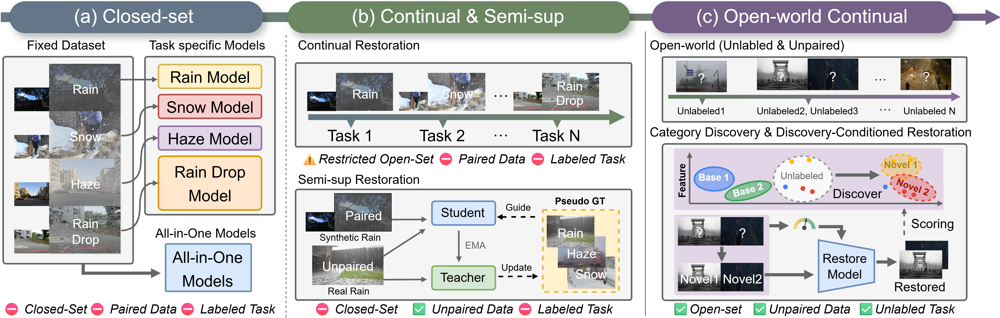
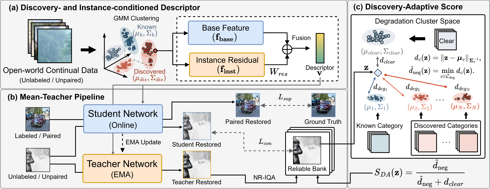

# DUDA

Official PyTorch implementation of **Discovering Unseen Degradations to Adapt Semi-Supervised Image Restoration** (**NeurIPS 2026**).

[[Project page](https://bo-oseng.github.io/DUDA/)]
[[Pretrained models](https://huggingface.co/ses7720/DUDA)]
[[Datasets](https://huggingface.co/datasets/ses7720/DUDA-WRES)]
[[Docker image](https://huggingface.co/ses7720/DUDA/tree/main/docker)]
[Paper (coming soon)]
[Live demo (coming soon)]

**TL;DR:** We introduce semi-supervised continual image restoration, where unseen degradations arrive in unlabeled, unpaired streams, and propose DUDA, which discovers them and uses them to guide restoration and pseudo-target selection.



*From predefined restoration tasks to unlabeled image streams: DUDA couples novel degradation discovery with adaptive restoration.*

## Lay Summary

Security cameras and autonomous cars often capture hard-to-see images in rain, snow, fog or darkness. AI tools can fix these, but are usually trained on a fixed list of problems, using pairs of damaged and clear photos of the same scene. Outdoors, new and mixed conditions keep appearing, and such pairs rarely exist: no one can photograph a street in storm and sunshine at once.

We present DUDA, which keeps learning on the job without clear photos or human labels. Like a birdwatcher who starts a new page for a bird missing from the guidebook and adds later sightings to it, DUDA sorts images by type of damage, adding new types as they appear. These discoveries guide each repair, and DUDA learns only from its most trustworthy results.

This could keep outdoor cameras reliable as conditions change. In tests, its restored images also helped detectors spot cars and people better.

## Method



Starting from a model trained on known degradations, DUDA continually restores
incoming images whose degradations may be unknown, mixed and changing over time,
without degradation labels or paired clean targets. It connects continual
category discovery to restoration through two components in a mean-teacher
pipeline:

- **Discovery- and instance-conditioned descriptor.** Soft assignments over
  known and discovered degradation clusters combine prototype-initialized
  embeddings with covariance-normalized instance residuals, conditioning
  restoration on both the degradation structure and each image.
- **Discovery-adaptive score.** Relative Mahalanobis distances to an anchored
  clear cluster and the nearest degradation cluster give a degradation-aware
  signal for pseudo-target selection. Together with no-reference image quality
  assessment, it refines the reliable bank and mitigates degradation
  composition bias.
- **Mean-teacher adaptation.** An EMA teacher supplies candidate pseudo-targets
  for unpaired real images; the student learns from paired base data and
  reliable pseudo-targets.

<details>
<summary>Code structure</summary>

```text
discovery/                          # continual category discovery (VB-CGCD)
├── train_adapter.py                # DINOv3 + BOFT adapter on the known degradations, feature export
├── extract_real_features.py        # features of the unlabeled real images
├── run_vbcgcd.py                   # VB-CGCD: known clusters + discovered clusters
└── utils_lib/                      # dino_adapter, datasets, vbcgcd (classifier), gmm
restoration/                        # restoration
├── train_supervised.py             # supervised initialization on paired data
├── train_semi_supervised.py        # semi-supervised adaptation (mean teacher + reliable bank)
├── infer.py                        # restore one image with the released checkpoints
├── evaluate.py                     # MUSIQ, CLIP-IQA, LIQE on real-world sets
├── evaluate_qalign.py              # Q-Align on the saved restorations
└── utils_lib/
    ├── descriptor.py               # discovery- and instance-conditioned descriptor (Sec. 3.2)
    ├── discovery_adaptive_score.py # discovery-adaptive score S_DA (Sec. 3.3)
    ├── reliable_bank.py            # reliable-bank update: MUSIQ, then S_DA
    ├── mean_teacher.py             # EMA teacher and consistency-weight ramp-up
    ├── losses.py                   # structure and perceptual losses
    ├── onerestore.py               # OneRestore backbone
    ├── dino.py                     # frozen DINOv3 + adapter
    └── datasets.py, checkpoint.py, real_eval.py, common.py
scripts/                            # launcher (run.py), data preparation, asset linking
```

</details>

## TODO

- [ ] Add the paper link and citation information.
- [ ] Add the live demo.

## Contents

- [Method](#method)
- [Quick start](#quick-start)
- [Installation](#installation)
- [Models and data](#models-and-data)
- [Data preparation](#data-preparation)
- [Training](#training)
- [Evaluation](#evaluation)
- [Continual streams](#continual-streams)

## Quick start

Restore a single image with the released model. This needs the
[Conda environment](#installation), the pretrained bundle, and the DINOv3 base
weights; the training datasets are not required.

```bash
# 1. Pretrained bundle
hf download ses7720/DUDA --include "duda-pretrained.tar.gz*" SHA256SUMS --local-dir downloads/duda-models
(cd downloads/duda-models && sha256sum -c SHA256SUMS)
tar -xzf downloads/duda-models/duda-pretrained.tar.gz -C downloads/duda-models
B=downloads/duda-models/duda-pretrained
python scripts/link_assets.py --features $B/features --dino-adapter $B/dino_adapter --cgcd $B/cgcd \
  --stage0 $B/checkpoints/stage0_latest.pth --adapted $B/checkpoints/semi_supervised_epoch10.pth

# 2. DINOv3 base weights (gated; see "DINOv3 base weights" below)
hf download facebook/dinov3-vitl16-pretrain-lvd1689m \
  --revision ea8dc2863c51be0a264bab82070e3e8836b02d51 \
  --include config.json model.safetensors preprocessor_config.json LICENSE.md README.md \
  --local-dir assets/dino_base

# 3. Restore
CUDA_VISIBLE_DEVICES=0 python restoration/infer.py \
  --input /absolute/path/to/input.jpg --output outputs/restored.png
```

`infer.py` loads the adapted teacher by default; add `--stage 0` for the
supervised initialization. Input dimensions are center-cropped to a multiple of 16.

<details>
<summary>Run the same inference with Docker</summary>

```bash
export DUDA_INPUT=/absolute/path/to/input.jpg
B="$PWD/downloads/duda-models/duda-pretrained"
mkdir -p outputs
docker run --rm --gpus '"device=0"' --shm-size=2g \
  -v "$PWD/assets/dino_base:/app/assets/dino_base:ro" \
  -v "$B/dino_adapter:/app/assets/dino_adapter:ro" \
  -v "$B/cgcd:/app/assets/cgcd:ro" \
  -v "$B/features:/app/assets/features:ro" \
  -v "$B/checkpoints:/app/assets/checkpoints:ro" \
  -v "$DUDA_INPUT:/inputs/input.jpg:ro" \
  -v "$PWD/outputs:/app/outputs" \
  duda:neurips2026 python restoration/infer.py \
    --input /inputs/input.jpg --output outputs/restored.png
```

</details>

## Installation

Use either a Conda environment in this repository or the published Docker
image. Download commands use the `hf` CLI from `huggingface_hub`.

### Option A: Conda

Tested with Python 3.11, PyTorch 2.4.0, torchvision 0.19.0, Transformers 4.56.0,
PEFT 0.12.0 and PyIQA 0.1.14.1 on CUDA 12.1.

```bash
sudo apt-get update && sudo apt-get install -y gcc g++ libgl1 libglib2.0-0 zstd

CONDA_CHANNEL_PRIORITY=strict conda env create -f environment.yml
conda activate duda
export CUDA_HOME="$CONDA_PREFIX"
python -m pip install torch==2.4.0 torchvision==0.19.0 torchaudio==2.4.0 --index-url https://download.pytorch.org/whl/cu121
python -m pip install -r requirements.txt
python -m pip install --no-deps pyiqa==0.1.14.1
```

BOFT compiles a CUDA extension on first use, so `nvcc`, Ninja and GCC/G++ must
be available; `environment.yml` provides nvcc 12.1.

### Option B: Docker

Install Docker, the NVIDIA Container Toolkit and `zstd`, then load the image:

```bash
hf download ses7720/DUDA --include "docker/*" --local-dir downloads/duda-docker
(cd downloads/duda-docker/docker && sha256sum -c SHA256SUMS)
zstd -dc downloads/duda-docker/docker/duda-neurips2026.tar.zst | docker load
```

The loaded image is **`duda:neurips2026`**. It contains the CUDA toolchain,
Python packages and this code; model weights and datasets are mounted at run
time. The image can also be built from this repository with the `Dockerfile`.

### DINOv3 base weights

Both options use the same DINOv3 base model. Request access on the
[official model page](https://huggingface.co/facebook/dinov3-vitl16-pretrain-lvd1689m),
then download it with an account that has access:

```bash
hf auth login
hf download facebook/dinov3-vitl16-pretrain-lvd1689m \
  --revision ea8dc2863c51be0a264bab82070e3e8836b02d51 \
  --include config.json model.safetensors preprocessor_config.json LICENSE.md README.md \
  --local-dir assets/dino_base
```

Once downloaded, no Hugging Face login is needed. Set `DUDA_DINO_BASE` to use
another location.

## Models and data

All assets are on Hugging Face and come with SHA-256 checksums. Sizes are
compressed download sizes.

| Download | Contents | Size |
| --- | --- | --- |
| [Pretrained bundle](https://huggingface.co/ses7720/DUDA/blob/main/duda-pretrained.tar.gz) | Restoration checkpoints, VB-CGCD parameters and the DINOv3 BOFT adapter | 203 MB |
| [Docker image](https://huggingface.co/ses7720/DUDA/tree/main/docker) | Runtime and code, tag `duda:neurips2026` | 7.00 GB |
| [Supervised data](https://huggingface.co/datasets/ses7720/DUDA-WRES/blob/main/base/syn_train_dataset.tar.zst) | Paired known-degradation data and clean discovery images | 21.99 GB |
| [Real training data](https://huggingface.co/datasets/ses7720/DUDA-WRES/blob/main/base/real_train_dataset.tar.zst) | Unpaired images of the three novel degradation classes | 1.15 GB |
| [Evaluation data](https://huggingface.co/datasets/ses7720/DUDA-WRES/blob/main/base/real_eval_dataset.tar.zst) | RealRain-2320, RTTS and Snow100K-R | 2.62 GB |
| [Real training patches](https://huggingface.co/datasets/ses7720/DUDA-WRES/blob/main/optional/real_train_patches.tar.zst) | 224x224 patches cropped from the 6,772 real training images (183,313 in total; can also be generated with `prepare_datasets.py`) | 12.91 GB |

The pretrained bundle extracts to `duda-pretrained/` with:

| Path | Role |
| --- | --- |
| `checkpoints/stage0_latest.pth` | Supervised initialization, epoch 500 |
| `checkpoints/semi_supervised_epoch10.pth` | Adapted model, epoch 10 / step 14,470; the teacher is used by default |
| `cgcd/` | PCA, scaler, class mapping and per-stage Gaussian means/covariances |
| `dino_adapter/` | BOFT adapter, base-layer biases and classification head |
| `features/.../class_order.txt` | Degradation class order |
| `manifest.json` | Per-file checksums |

`scripts/link_assets.py` links these files into `assets/`, where the launcher
looks for them (see [Quick start](#quick-start)).

## Data preparation

The default data root is `datasets/wres_datasets`; set `DATA_ROOT` to use
another location. With Docker, run the same `scripts/prepare_datasets.py`
commands inside `duda:neurips2026` with
`-v "$PWD/datasets/wres_datasets:/app/datasets/wres_datasets"`.

**1. Download the base data.**

```bash
hf download ses7720/DUDA-WRES --repo-type dataset \
  --include "base/*" SHA256SUMS archives.json README.md \
  --local-dir downloads/duda-wres
(cd downloads/duda-wres && grep '  base/' SHA256SUMS | sha256sum -c -)
mkdir -p datasets
for name in syn_train_dataset real_train_dataset real_eval_dataset; do
  tar --zstd -xf "downloads/duda-wres/base/$name.tar.zst" -C datasets
done
```

**2. Generate or download the real training patches.** Either generate them
from the real training images:

```bash
python scripts/prepare_datasets.py patches --num-workers 8
```

or download the precomputed archive instead:

```bash
hf download ses7720/DUDA-WRES optional/real_train_patches.tar.zst --repo-type dataset \
  --local-dir downloads/duda-wres
(cd downloads/duda-wres && grep '  optional/' SHA256SUMS | sha256sum -c -)
tar --zstd -xf downloads/duda-wres/optional/real_train_patches.tar.zst -C datasets
```

Patches are 224x224 crops on a 224-pixel grid, with a final border position for
full coverage.

**3. (Optional) Create the monitoring subset** (232 RealRain, 432 RTTS and 133
Snow100K-R images). Semi-supervised adaptation reports MUSIQ and CLIP-IQA on it
every 200 steps and skips this monitoring when it is absent. Final evaluation
uses the full sets.

```bash
python scripts/prepare_datasets.py eval-subset
```

The resulting layout:

```text
datasets/wres_datasets/
├── syn_train_dataset/       # supervised paired data and clean discovery images
├── real_train_dataset/      # unpaired real images
├── real_train_patches/      # 224x224 patches
├── real_eval_dataset/       # full evaluation sets
└── real_eval_small_dataset/ # monitoring subset (optional)
```

Existing data can be linked with `python scripts/link_assets.py --data /path/to/wres_datasets`.

## Training

Run from the repository root. Outputs (features, checkpoints, logs and resolved
configurations) go to `outputs/`. Select GPUs with `CUDA_VISIBLE_DEVICES` and set
`NPROC_PER_NODE` to the number of GPU processes (default: 3). Add `--dry-run` to
any stage to print its command and configuration without running it.

With Docker, use the mounts from the inference example plus
`-v "$PWD/datasets/wres_datasets:/app/datasets/wres_datasets:ro"`, and run
`python scripts/run.py <stage>` as the container command.

**1. Degradation discovery.** Learn degradation features, extract features of
the unlabeled real images, and fit VB-CGCD:

```bash
python scripts/run.py features
FEATURE_ROOT="$PWD/outputs/features" python scripts/run.py cgcd
```

Results are written to `outputs/features/` and `outputs/cgcd/`. To use them in
the next stages, link them with `scripts/link_assets.py` or set `FEATURE_ROOT`,
`DINO_ADAPTER_DIR` and `CGCD_DIR`.

**2. Supervised initialization** on paired base data for 500 epochs
([`configs/supervised.yml`](configs/supervised.yml)):

```bash
python scripts/run.py supervised
```

The model is saved to `outputs/checkpoints/supervised/checkpoint_latest.pth`.

**3. Semi-supervised adaptation** for 10 epochs
([`configs/semi_supervised.yml`](configs/semi_supervised.yml)). By default it
starts from the released supervised checkpoint; set `STAGE0_CHECKPOINT` to use
your own:

```bash
STAGE0_CHECKPOINT=outputs/checkpoints/supervised/checkpoint_latest.pth \
  python scripts/run.py semi_supervised
```

The adapted model is saved to `outputs/checkpoints/semi_supervised/stage1_latest.pth`
and the reliable bank to `outputs/reliable_bank/semi_supervised/`. Set
`RESUME_CHECKPOINT` to resume an interrupted run.

## Evaluation

Evaluate the adapted teacher on **RealRain-2320, RTTS and Snow100K-R** with
MUSIQ, CLIP-IQA and LIQE:

```bash
python scripts/run.py evaluate
```

This loads `assets/checkpoints/semi_supervised_epoch10.pth` and saves restored
images and metrics to `outputs/results/table1/`. Set `CHECKPOINT` to evaluate
another checkpoint and `RESULTS_ROOT` to change the output directory. The values
reported in Table 1 are listed in [`reference/table1_metrics.json`](reference/table1_metrics.json).

**Q-Align** needs a separate environment, because its model code requires an
older Transformers version than DINOv3:

```bash
conda create -n duda-qalign python=3.10 -y
conda activate duda-qalign
python -m pip install torch==2.1.2 torchvision==0.16.2 --index-url https://download.pytorch.org/whl/cu121
python -m pip install -r requirements-qalign.txt
export QALIGN_PYTHON="$(which python)"
conda activate duda
NPROC_PER_NODE=1 python scripts/run.py qalign
```

It scores the images saved by `evaluate`; use the same `RESULTS_ROOT` for both
if you override it.

## Continual streams

Beyond the main 6+3 setting, we release the 6+1+2 and 6+1+1+1 streams, where
the unseen degradations arrive over several stages. See [CONTINUAL.md](CONTINUAL.md)
for their checkpoints, training and evaluation.

## Acknowledgements

DUDA builds on VB-CGCD for continual category discovery, OneRestore for the
restoration backbone, and the mean-teacher framework of Semi-UIR. The
implementation also uses [DINOv3](https://github.com/facebookresearch/dinov3),
[PEFT](https://github.com/huggingface/peft), [PyIQA](https://github.com/chaofengc/IQA-PyTorch),
NumPyro, JAX, scikit-learn and Continuum. We thank the authors and the
open-source community for their contributions.
